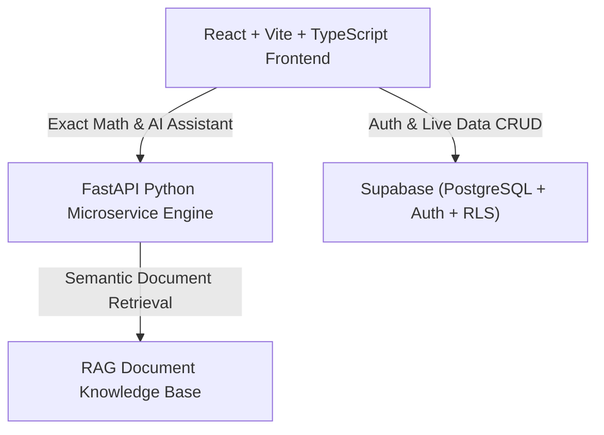

# FinOracle AI — A RAG-Powered Financial Scenario Analysis & Simulation System

> **Understand Your Money. Simulate Your Future. Make Smarter Decisions.**

FinOracle AI is an intelligent full-stack financial simulation platform. It blends deterministic financial mathematics (exact amortization schedules, multi-variable What-If shock simulations, cashflow pacing) with conversational AI grounded in certified personal finance documents and real-time database persistence.

---

## Architecture Overview



### Technology Stack

- **Frontend**: React 18, TypeScript, Vite, Tailwind CSS, Framer Motion, Lucide React
- **Visualizations**: Recharts (Area, Bar, Donut Pie, Line charts)
- **Forms & Validation**: React Hook Form, Zod
- **Exports**: jsPDF, jspdf-autotable, PapaParse (CSV)
- **Backend API**: Python 3, FastAPI, Uvicorn, Pydantic
- **Testing**: Python unittest / Pytest, Vitest
- **Database & Auth**: Supabase (PostgreSQL with Row Level Security)

---

## Project Folder Structure

```
finOracleAi/
├── backend/                  # FastAPI Python microservice
│   ├── models/               # Pydantic schemas (LoanRequest, ScenarioRequest, etc.)
│   ├── routers/              # Modular API endpoints (loans, scenarios, assistant)
│   ├── services/             # Pure math engine & RAG retriever
│   ├── tests/                # Automated unit tests for calculations
│   ├── main.py               # FastAPI entrypoint with CORS & routes
│   └── requirements.txt      # Python dependencies
├── src/                      # Frontend React + Vite application
│   ├── components/           # UI components, layout, and auth wrappers
│   │   ├── auth/             # ProtectedRoute wrapper
│   │   ├── layout/           # Sidebar, AppLayout
│   │   └── ui/               # Card, StatCard, Modal, Badge, ProgressBar, etc.
│   ├── contexts/             # AuthContext with resilient demo/offline fallback
│   ├── lib/                  # Supabase client instantiation
│   ├── pages/                # Application views (Dashboard, Loans, Scenarios, etc.)
│   ├── services/             # Supabase & mockData reactive store
│   ├── styles/               # globals.css with custom glassmorphism design tokens
│   ├── types/                # TypeScript interface definitions
│   ├── utils/                # Currency formatters, date math, color generators
│   ├── App.tsx               # Client router setup
│   └── main.tsx              # React DOM root entry
├── index.html                # Vite HTML entrypoint
├── supabase_schema.sql       # Complete PostgreSQL migration with RLS policies
├── .env.example              # Environment variables template
├── .gitignore                # Git exclusion rules
├── package.json              # Frontend npm dependencies and scripts
├── tailwind.config.js        # Design tokens and theme configuration
├── tsconfig.json             # TypeScript configuration
└── vite.config.ts            # Vite bundler configuration
```

---

## Key Modules & Capabilities

1. **Dashboard (`/dashboard`)**: Real-time cashflow metrics, income vs. expense trends, category spending distribution, savings rate, and active goal highlights.
2. **Transactions (`/transactions`)**: Full CRUD ledger, search, category filter, pagination, CSV bulk import with column preview, and CSV statement export.
3. **Budget Management (`/budgets`)**: Monthly category spending caps, utilization percentages, dynamic warning badges, and remaining cushion alerts.
4. **Goal Guardian (`/goals`)**: Financial aspirations tracker with target pacing analysis, required monthly deposit math, and one-click quick contributions.
5. **Loan Analyzer (`/loans`)**: Standard EMI calculator, full 240-month amortization schedule, and interactive prepayment accelerator showing months and interest saved.
6. **What-If Scenario Simulator (`/scenarios`)**: Multi-shock simulation studio (career promotions, loan EMIs, capital outlays, inflation shocks) with 12-month wealth trajectory curves and Supabase persistence.
7. **AI Assistant (`/assistant`)**: RAG-powered chat with conversation history, clickable source citations, and fallback financial planning intelligence.
8. **Reports & Exports (`/reports`)**: Executive financial statement generator exporting branded PDF reports and CSV audits.
9. **Financial Literacy Lab (`/learn`)**: Interactive SIP wealth compounder, emergency fund sizer, and Rule of 72 doubling calculator.
10. **Settings (`/settings`)**: Profile info, default income, currency selection (INR, USD, EUR, GBP), and security audit.

---

## Environment Variables

Copy `.env.example` to `.env` to configure your environment:

| Variable | Description | Default / Example |
|---|---|---|
| `VITE_SUPABASE_URL` | Public Supabase project URL | `https://your-project.supabase.co` |
| `VITE_SUPABASE_PUBLISHABLE_KEY` | Public anon key for client queries | `eyJhbGci...` |
| `SUPABASE_SERVICE_ROLE_KEY` | Server-only admin key (backend only) | `YOUR_SERVICE_ROLE_KEY` |
| `LLM_API_KEY` | API Key for LLM reasoning | `YOUR_LLM_API_KEY` |
| `VITE_API_URL` | Frontend reference to backend API | `http://localhost:8000/api` |

> **Note**: FinOracle AI includes a built-in resilient local offline mode. If Supabase credentials are not provided or unconfigured, the platform automatically activates mock storage so you can explore all modules immediately!

---

## Getting Started

### 1. Database Setup (Supabase)
1. Create a Supabase project at [supabase.com](https://supabase.com).
2. Open the **SQL Editor** in your Supabase dashboard.
3. Paste and run the contents of [`supabase_schema.sql`](supabase_schema.sql).
4. Copy your Project URL and anon publishable key into `.env`.

### 2. Frontend Launch
```bash
# Install dependencies
npm install

# Start Vite dev server
npm run dev
```
Open [http://localhost:5173](http://localhost:5173) in your browser.

### 3. Backend Launch (Optional)
```bash
# Install backend dependencies
pip install -r backend/requirements.txt

# Run FastAPI backend
python -m backend.main
```
Backend runs on [http://localhost:8000](http://localhost:8000) with interactive Swagger docs at [http://localhost:8000/docs](http://localhost:8000/docs).

### 4. Running Backend Unit Tests
```bash
python -m unittest backend/tests/test_calculations.py
```
